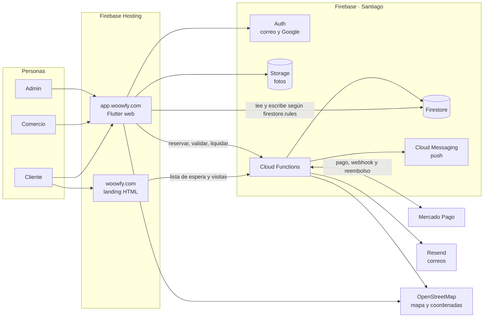
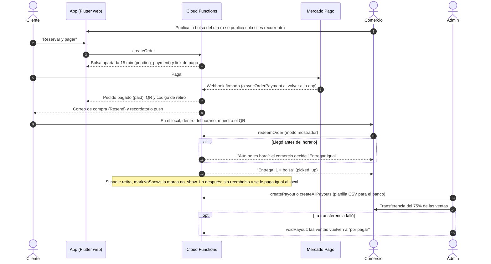
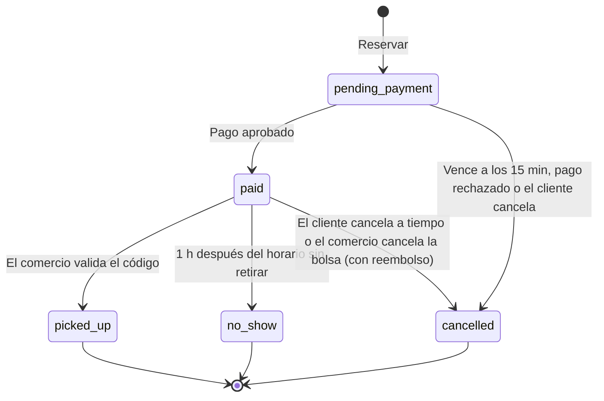
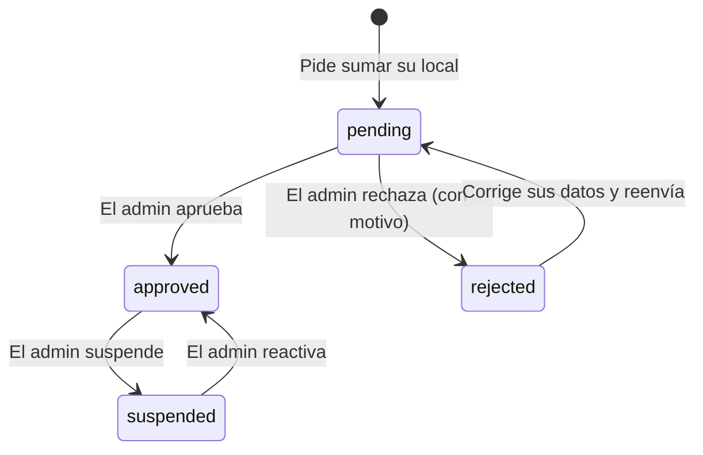

# Woowfy

Marketplace de **bolsas sorpresa** contra el desperdicio de comida: los locales publican lo que no
vendieron en el día, los clientes lo reservan y pagan en línea, y lo retiran con un código QR.
Chile primero, luego Latam.

- **Landing:** https://woowfy.com (modo "en construcción" con lista de espera)
- **App:** https://app.woowfy.com
- **Hoja de ruta y estado:** [ROADMAP.md](ROADMAP.md) · **Producto y principios de diseño:** [PRODUCT.md](PRODUCT.md)
- Un producto de **Passva SpA** (contacto: hola@passva.com)

## Cómo funciona

### Piezas del sistema

Dos sitios en Firebase Hosting (la landing y la app) sobre un solo proyecto de Firebase. Todo lo que mueve
dinero o códigos de retiro pasa por Cloud Functions: la app nunca escribe pedidos ni liquidaciones.



### Una compra, de punta a punta



### Estados de un pedido



### Estados de un local



## Stack

| Parte | Tecnología |
|---|---|
| App (web hoy; Android/iOS después) | Flutter · go_router · Material 3 · flutter_map (OpenStreetMap) |
| Landing | HTML + CSS estático (`landing/`), pensado para SEO, con lista de espera y páginas legales |
| Backend | Firebase: Auth (correo + Google), Firestore, Storage (fotos), Cloud Functions (TypeScript, Node 22), Cloud Messaging (push), Hosting |
| Pagos | Mercado Pago Checkout Pro en **producción** (cuenta de Passva SpA). Proveedor intercambiable: `mock` en los emuladores |
| Correos | Resend (dominio `woowfy.com` verificado el 25-10-2026) |
| Builds móviles | Codemagic (`codemagic.yaml`), para compilar iOS sin Mac |

Proyecto Firebase: **`woowfy-app`** (plan Blaze). Paquete Android / Bundle iOS: `com.woowfy.woowfy`.

## Inventario de servicios

Todo lo que Woowfy usa fuera del repositorio, dónde vive y para qué. Al agregar o mover un servicio, actualizar aquí.

### Google Cloud / Firebase (proyecto `woowfy-app`, plan Blaze)

| Servicio | Región | Para qué | Notas |
|---|---|---|---|
| Firestore (modo nativo) | `southamerica-west1` (Santiago) | Base de datos: locales, bolsas, pedidos, liquidaciones, configuración | Reglas en `firestore.rules`, índices en `firestore.indexes.json` |
| Cloud Functions (2.ª gen, Node 22) | Santiago y São Paulo (ver tabla de abajo) | Toda la lógica de dinero, correos, avisos y tareas programadas | Código en `functions/src` |
| Cloud Scheduler | `southamerica-east1` (São Paulo) | Dispara las 4 funciones programadas | No existe en Santiago |
| Cloud Storage | Santiago | Fotos de bolsas y logos (`uploads/{uid}/…`) | Bucket `woowfy-app.firebasestorage.app`; reglas en `storage.rules`; CORS en `storage-cors.json` |
| Firebase Authentication | Global | Ingreso con correo y con Google | `authDomain` = `app.woowfy.com`; cliente OAuth en Google Auth Platform |
| Firebase Hosting | Global (CDN) | Sitio `woowfy-app` → `woowfy.com` (landing) · sitio `woowfy-app-web` → `app.woowfy.com` (app) | Guarda las últimas 5 versiones de cada sitio |
| Cloud Messaging (FCM) | Global | Notificaciones push web | Inactivo hasta poner la clave VAPID en `lib/core/push.dart` |
| Secret Manager | Global | `MP_ACCESS_TOKEN`, `MP_WEBHOOK_SECRET`, `RESEND_API_KEY` | Nunca en archivos del repositorio |
| Cloud Build / Artifact Registry | Región de cada función | Compila y guarda las imágenes de las funciones al desplegar | Las imágenes se borran a 1 día |

### Cloud Functions por región

| Región | Funciones |
|---|---|
| **`southamerica-west1`** (Santiago), 22 | **Pedidos y pagos:** `createOrder`, `syncOrderPayment`, `cancelOrder`, `cancelBag`, `redeemOrder`, `confirmMockPayment` (solo con `mock`), `retryRefund`, `mercadoPagoWebhook` (HTTP) · **Liquidaciones:** `createPayout`, `createAllPayouts`, `voidPayout` · **Calificaciones:** `rateOrder` · **Correos:** `onOrderUpdated`, `onWaitlistCreated`, `sendTestEmail`, `previewEmail` · **Locales y bolsas:** `onStoreCreated`, `onStoreUpdated`, `onBagCreated`, `onBagTemplateWritten` · **Landing:** `joinWaitlist` (HTTP, `/api/waitlist`), `trackEvent` (HTTP, analítica anónima) |
| **`southamerica-east1`** (São Paulo), 4 programadas | `expirePendingOrders` (cada 5 min) · `markNoShows` (cada 30 min) · `sendPickupReminders` (cada 15 min) · `publishRecurringBags` (todos los días, 05:00 hora de Chile) |

Todas usan 256 MB y como máximo 10 instancias (`setGlobalOptions` en `functions/src/index.ts`).

### Servicios externos

| Servicio | Cuenta / plan | Región | Para qué | Configuración |
|---|---|---|---|---|
| **Mercado Pago** (Checkout Pro) | Cuenta de **Passva SpA**, credenciales de **producción** (desde el 25-10-2026) | — | Cobros, reembolsos y conciliación | Webhook `https://southamerica-west1-woowfy-app.cloudfunctions.net/mercadoPagoWebhook` (evento Pagos); `MP_ACCESS_TOKEN` y `MP_WEBHOOK_SECRET` en Secret Manager |
| **Resend** | Equipo `passva`, plan gratis | `sa-east-1` (São Paulo) | Correos de bienvenida, compra y reembolso desde `hola@woowfy.com` | Dominio `woowfy.com` verificado (DKIM, SPF y DMARC); recepción **desactivada**; clave "Woowfy Key" solo de envío, guardada como `RESEND_API_KEY` |
| **Piensa Solutions** | Registrador y DNS de `woowfy.com` | — | Dominio y todos sus registros DNS | Ver [Dominios](#dominios) |
| **OpenStreetMap** | Sin cuenta ni clave | — | Mapa de la app (teselas, `flutter_map`) y geocodificación de direcciones (Nominatim, desde `functions/src/geo.ts`) | Máx. 1 consulta por segundo a Nominatim |
| **Google Fonts** | Sin cuenta | — | Tipografía Lato en la landing y las páginas legales | — |
| **jsDelivr** | Sin cuenta | — | Lector de QR en la web (jsQR) | — |
| **Google Search Console** | Cuenta de Google | — | Verificación e indexación de `woowfy.com` | TXT `google-site-verification` en el DNS |
| **Codemagic** | Aún sin usar | — | Compilar Android/iOS en la nube | `codemagic.yaml` |

Contacto público: `hola@passva.com` (Passva SpA). `hola@woowfy.com` solo envía, a través de Resend.

## Estructura

```
lib/
  main.dart, app.dart
  core/          tema y logo, router, formato CLP y fechas, errores en español (con "Reintentar"),
                 RUT, backend (emuladores/región), checkout, ubicación, push (FCM), instalación PWA,
                 enlaces legales, analítica anónima, puente al escáner QR web (web_qr)
  data/          modelos, repositorio Firestore/Functions/Storage, regiones de Chile
  features/
    shell/       navegación principal (Bolsas / Mis pedidos / Cuenta) y encabezado verde
    home/        bolsas del día: región, filtros, orden, mapa y distancia; sin bolsas, "cómo funciona" y
                 lista de espera dentro de la app
    bags/        tarjeta, detalle (favorito, compartir) y "Reservar y pagar"
    auth/        ingreso / registro (correo y Google), recuperar contraseña
    orders/      checkout simulado, comprobante con QR (guardado para usar sin señal), confirmación
                 automática del pago, "Mis pedidos"
    account/     cuenta: nombre, tu impacto, notificaciones, instalar app, legales
    merchant/    panel del comercio: solicitud (y corrección si se rechaza), perfil, bolsas (y recurrentes),
                 stock, cancelar bolsa, modo mostrador (validar retiros con QR), ventas y pagos, cuenta
                 bancaria, enlace a la guía para comercios
    admin/       solicitudes, comercios, pagos (liquidar, liquidar todos, anular, historial), ventas,
                 analítica, interesados, usuarios, correo; aviso para lanzar la landing arriba de todo
assets/brand/    isotipo usado en la app
functions/src/
  orders.ts          createOrder, confirmMockPayment, redeemOrder (avisa si llega antes del horario),
                     expirePendingOrders, markNoShows,
                     cancelOrder (cliente), cancelBag (comercio), mercadoPagoWebhook, syncOrderPayment
  payments.ts        PaymentProvider: mock | mercadopago (Checkout Pro, reembolsos, firma del webhook)
  reviews.ts         rateOrder: calificación de pedidos retirados y nota del local
  payouts.ts         createPayout / createAllPayouts: liquidación de ventas a un local o a todos (admin);
                     voidPayout: anula una liquidación y sus ventas vuelven a "por pagar"
  waitlist.ts        joinWaitlist (formulario "Avísame" de la landing y de la app sin bolsas)
  email.ts           correos vía Resend: onWaitlistCreated (bienvenida), onOrderUpdated (compra y reembolso),
                     previewEmail y sendTestEmail (vista previa y prueba desde el admin)
  analytics.ts       trackEvent: contadores anónimos de visitas por día (/api/track)
  recurring.ts       bolsas recurrentes: onBagTemplateWritten + publishRecurringBags (05:00 Chile)
  stores.ts          onStoreCreated/onStoreUpdated: coordenadas y copia del perfil a sus bolsas
  geo.ts             geocodificación de direcciones (Nominatim / OpenStreetMap)
  notifications.ts   push: aviso a seguidores (onBagCreated) y recordatorio de retiro (cada 15 min)
  chile.ts           regiones de Chile (validación)
functions/scripts/seed-emulators.mjs   datos y cuentas de prueba para los emuladores
landing/         woowfy.com: index.html, merchants.html (guía para comercios), terms.html, privacy.html,
                 site.js (modo lanzamiento + analítica), íconos, og-image, manifest
web/             index.html, qr_scanner.js (escáner QR web), firebase-messaging-sw.js, manifest, íconos
brand/           brand kit v2 original + brand/fixed/ (íconos corregidos)
tool/
  stamp-web-build.mjs        agrega ?v=<hash> a main.dart.js en cada deploy (evita caché vieja)
  set-storage-cors.mjs       aplica storage-cors.json al bucket (necesario para ver fotos en la app)
  backfill-store-coords.mjs  calcula coordenadas de locales que no las tienen
  preview-emails.mjs         genera los correos de ejemplo en build/emails/*.html (no envía nada)
firestore.rules, firestore.indexes.json, storage.rules, storage-cors.json
```

## Perfiles

| Perfil | Cómo se obtiene | Qué hace |
|---|---|---|
| Cliente | Registrándose | Ve bolsas (lista o mapa), sigue locales, reserva y paga, retira con QR |
| Comercio | Un usuario pide sumar su local y un admin lo aprueba (si lo rechaza, corrige y reenvía) | Perfil del local, publica bolsas (o recurrentes), valida retiros, ve ventas y registra su cuenta bancaria |
| Admin | `role: admin` en `users/{uid}` | Aprueba comercios, liquida (y anula) pagos, ve ventas, analítica e inscritos, lanza la landing, gestiona usuarios y correo |

El primer admin se asignó a mano; los siguientes se dan desde **Admin → Usuarios**.

## Modelo de datos (Firestore)

| Colección | Contenido | Quién escribe |
|---|---|---|
| `users/{uid}` | email, nombre, `role` (`customer` \| `admin`), `fcmTokens` (push) | el usuario (sin cambiar su rol); admin |
| `users/{uid}/favorites/{storeId}` | locales que sigue el usuario | el propio usuario |
| `stores/{id}` | local: categoría, logo, descripción, horario, dirección, `lat/lng`; `status`: `pending` → `approved` / `rejected` / `suspended` | el dueño crea y edita su perfil; admin cambia el estado |
| `bags/{id}` | bolsa del día: precio (mínimo $500), stock (`quantityAvailable`) y cantidad publicada (`quantity`), horario, foto, categoría, logo y coordenadas del local | comercio aprobado (o la función de recurrentes); admin puede pausar |
| `bagTemplates/{id}` | bolsa recurrente: días de la semana, horario `HH:mm`, precio, cantidad | comercio aprobado |
| `orders/{id}` | compra: estado, monto, precio original, comisión, código de retiro, cancelación y reembolso, calificación, liquidación | **solo Cloud Functions** |
| `orders/{id}/private/pickup` | código de retiro del pedido | **solo Cloud Functions**; lo lee solo el cliente |
| `stores/{id}/private/bank` | cuenta bancaria del local para liquidaciones | dueño y admin |
| `stats/{yyyy-mm-dd}` | contadores anónimos de visitas por día (analítica) | **solo la función** `trackEvent`; lo lee el admin |
| `config/site` | modo de la landing (`launched`): en construcción o lanzada | lectura pública; lo cambia el admin |
| `pickupCodes/{storeId}_{código}` | índice de códigos vigentes para validar retiros | **solo Cloud Functions**; sin acceso desde la app |
| `reviews/{orderId}` | calificación (1–5) y comentario de un pedido retirado | **solo la función** `rateOrder`; lectura pública |
| `payouts/{id}` | pago de Woowfy a un comercio: pedidos, ventas, comisión, monto, nota, cuenta de destino (`destination`) y anulación (`voidedAt`, `voidReason`) | **solo funciones** (`createPayout`, `createAllPayouts`, `voidPayout`); lo ve el admin y el comercio (sin las anuladas) |
| `waitlist/{hash}` | inscritos de la landing y de la app: nombre, correo, tipo, región, comuna, origen, estado del correo | **solo funciones**; lee (y borra) el admin |
| `config/email` | interruptor general, correos de pedidos (`orderEmails`) y remitente | solo admin (Admin → Correo) |

Estados de un pedido: `pending_payment` (bolsa reservada 15 min) → `paid` (muestra QR) →
`picked_up` (el comercio validó el código) o `no_show` (no se retiró a tiempo: sin reembolso y se le paga igual al local). `cancelled` si no se paga a tiempo, se rechaza el pago, el cliente
cancela (hasta 2 h antes del retiro o 15 min después de pagar, con reembolso) o el comercio cancela la bolsa
(reembolso y aviso). Cada pedido guarda el estado de sus correos en `emails.purchase` / `emails.refund`.
La nota de un local solo la escribe el servidor: las reglas impiden que el comercio la modifique.

## Rutas de la app

Las rutas van en inglés; los textos de la interfaz, en español de Chile.

| Ruta | Pantalla |
|---|---|
| `/` | Bolsas disponibles (todo Chile) — con barra de navegación |
| `/orders` | Mis pedidos — con barra de navegación |
| `/account` | Cuenta — con barra de navegación |
| `/bag/:id` | Detalle de una bolsa |
| `/login?from=…` | Ingreso / registro |
| `/order/:id` | Comprobante con QR |
| `/mock-checkout/:id` | Pago simulado |
| `/merchant` | Panel del comercio |
| `/merchant/sales` | Ventas y pagos del comercio |
| `/admin?tab=…` | Panel admin; cada pestaña tiene su URL (`solicitudes`, `comercios`, `pagos`, `ventas`, `analitica`, `interesados`, `usuarios`, `correo`) |

Landing: `/`, `/merchants` (guía para comercios), `/terms`, `/privacy`, `/api/waitlist` (rewrite hacia
`joinWaitlist`) y `/api/track` (analítica, también en la app).

## Desarrollo local (emuladores)

Los emuladores no tocan la base real.

```bash
firebase emulators:start --only auth,firestore,functions
```

```bash
npm --prefix functions run seed
```

```bash
flutter run -d chrome --dart-define=USE_EMULATORS=true
```

- Cuentas de prueba (cliente, comercio aprobado, comercio pendiente y admin): ver
  `functions/scripts/seed-emulators.mjs`.
- Emulator UI: http://127.0.0.1:4000 · Los datos se borran al cerrar: vuelve a correr el `seed`.
- Las tareas programadas (vencer reservas, recurrentes, recordatorios) no se ejecutan en el emulador.
- El emulador de **Storage** falla con Java 25 (advertencia de `sun.misc.Unsafe`): sin él, el seed deja la
  bolsa de ejemplo sin foto. Las reglas de Storage se prueban con la Rules API (`projects.test`).
- Para las funciones con secretos, crea `functions/.secret.local` (ignorado por git) con valores de prueba:
  `RESEND_API_KEY=...`, `MP_ACCESS_TOKEN=TEST-...`, `MP_WEBHOOK_SECRET=...`.
- Producción usa Mercado Pago; para el emulador crea `functions/.env.local` (ignorado por git) con
  `PAYMENTS_PROVIDER=mock`, así el checkout es simulado.
- Si al iniciar dice que los puertos 4000/8080/9099 están ocupados, quedó un emulador anterior abierto.

Calidad:

```bash
flutter analyze
```

```bash
flutter test
```

```bash
npm --prefix functions run build
```

## Deploy

| Qué | Comando |
|---|---|
| Reglas e índices | `firebase deploy --only firestore` |
| Reglas de Storage | `firebase deploy --only storage` |
| Cloud Functions | `firebase deploy --only functions` |
| Landing | `firebase deploy --only hosting:landing` |
| App | `flutter build web --release` y luego `firebase deploy --only hosting:app` |

- Hosting guarda solo las **últimas 5 versiones** de cada sitio y las imágenes de las functions se borran a
  1 día, para no acumular deploys viejos.
- Nunca despliegues `build/web-emulators`: es un build que apunta a los emuladores.
- Si el build web se comporta distinto al de desarrollo (p. ej. un plugin "no disponible"), corre
  `flutter clean && flutter pub get`: el caché de Flutter puede quedar con un registro de plugins viejo.
- Revisa el build optimizado antes de publicar: algunos errores (como pasar funciones JS externas como valor)
  no los detecta `flutter analyze`, solo `flutter build web`.

Regiones: Firestore, Storage y las funciones en **Santiago** (`southamerica-west1`). Las tareas programadas
(`expirePendingOrders`, `markNoShows`, `publishRecurringBags`, `sendPickupReminders`) en **São Paulo**
(`southamerica-east1`), porque Cloud Scheduler no existe en Santiago.

## Dominios

DNS administrado en **Piensa Solutions**.

| Dominio | Registro DNS | Sitio de Firebase Hosting |
|---|---|---|
| `woowfy.com` | A `199.36.158.100` + TXT `hosting-site=woowfy-app` | `woowfy-app` (landing) |
| `www.woowfy.com` | CNAME `woowfy-app.web.app` | `woowfy-app` (landing) |
| `app.woowfy.com` | CNAME `woowfy-app-web.web.app` | `woowfy-app-web` (app) |

Registros de **Resend** (envío de correos desde `@woowfy.com`, agregados el 25-10-2026):

| Nombre | Tipo | Valor |
|---|---|---|
| `resend._domainkey` | TXT | Clave DKIM (`p=MIGfMA0…IDAQAB`, la entrega Resend) |
| `send` | CNAME | `send.forge.rmta.net` |
| `rsend` | CNAME | `rsend-sae1.forge.rmta.net` |
| `_dmarc` | TXT | `v=DMARC1; p=none;` |

`woowfy.com` no tiene MX: no recibe correos (la recepción de Resend está desactivada a propósito).

Un nombre con CNAME no puede tener otros registros, y el dominio raíz (`@`) no admite CNAME.
El TXT `google-site-verification` es de Google Search Console: no borrarlo.

**Inicio de sesión con Google:** el `authDomain` de la app es `app.woowfy.com` (en `lib/firebase_options.dart` y
`web/firebase-messaging-sw.js`), así Google muestra "Ir a woowfy.com" y el inicio de sesión ocurre en el mismo sitio
(mejor en Safari). Firebase Hosting sirve `/__/auth/handler` en ese dominio. Requisitos, ya configurados:
`https://app.woowfy.com/__/auth/handler` en las URIs de redirección del cliente OAuth web (Google Cloud →
Credenciales → "Web client (auto created by Google Service)") y `app.woowfy.com` en los dominios autorizados de
Firebase Auth. Si se cambia el dominio, primero se agrega la URI nueva en ese cliente; si no, el ingreso con Google
da `redirect_uri_mismatch`. La marca (nombre, logo `brand/fixed/logo-google-120.png`, enlaces legales) está en
Google Auth Platform → Información de la marca.

## Funcionalidades clave

- **Lista de espera:** el formulario "Avísame cuando lancen" de la landing envía a `/api/waitlist`, sin cargar
  Firebase en la página. La app usa la misma función cuando una región no tiene bolsas (con sesión, nombre y
  correo vienen escritos). Los inscritos se ven en **Admin → Interesados** (copiar correos o CSV).
- **Bolsas recurrentes:** el comercio activa "Repetir" y elige días; se publican solas a las 5:00 (hora de
  Chile, con horario de verano) o apenas se crean si aún es hora. El id diario evita duplicados.
- **Mapa y cercanía:** OpenStreetMap vía `flutter_map` (sin clave). Las coordenadas del local se calculan al
  crearlo o cambiar su dirección; para locales antiguos: `node tool/backfill-store-coords.mjs`. La ubicación
  del cliente la pide el navegador y solo se usa en el dispositivo.
- **Notificaciones push:** Firebase Cloud Messaging + `web/firebase-messaging-sw.js`. Necesitan la clave
  pública VAPID en `lib/core/push.dart` (`webPushVapidKey`); mientras esté vacía, la app muestra "Muy pronto".
- **Instalar la app (PWA):** `web/index.html` captura el evento del navegador y la pantalla Cuenta ofrece instalar.
- **Escáner QR (web):** `web/qr_scanner.js` abre una capa HTML propia sobre la app (cámara con `playsinline`,
  BarcodeDetector o jsQR). Funciona en Safari de iPhone, Chrome y computadores; si no hay cámara o permiso,
  explica cómo activarlo y ofrece escribir el código. `mobile_scanner` queda para la futura app nativa.
- **Modo mostrador:** "Validar retiro" deja la cámara abierta y valida un cliente tras otro (verde: entrega;
  rojo: no entregues; ámbar: "Aún no es hora", con "Entregar igual"). En hora de retiro (desde 30 min antes) es
  el botón flotante del panel. Al cliente se le pide llegar dentro del horario antes de pagar, en el comprobante
  y en el correo.
- **Publicar bolsas:** precio mínimo $500 (formulario y reglas). Al editar, "Quedan hoy" sube o baja el stock en una
  transacción (nunca bajo 0); "publicar igual que ayer" repite la cantidad de la última vez.
- **Código de retiro privado:** vive en `orders/{id}/private/pickup` (solo el cliente) y en
  `pickupCodes/{local}_{código}` (solo el servidor). El comercio lo valida cuando el cliente se lo muestra.
- **Pagos al local:** "Por recibir" suma pedidos retirados y no retirados (`no_show`, los marca `markNoShows`
  1 h después del retiro). El local registra su cuenta bancaria en *Ventas y pagos* con un flujo visual de 3 pasos
  (Agrega tu cuenta → Vende y entrega → Te transferimos), igual que en la guía. En **Admin → Pagos** se liquida
  por local o con **Liquidar todos**, que entrega una planilla CSV con titular, RUT, banco, cuenta y monto de cada
  local. Primero se transfiere y después se registra; cada liquidación guarda la cuenta de destino, y si la
  transferencia falló se **anula** (sus ventas vuelven a "por pagar").
- **Red de seguridad de pagos:** si el aviso de Mercado Pago no llega, `syncOrderPayment` (al volver del pago la
  app lo revisa sola cada 15 s durante 1 minuto, y luego con "Revisar de nuevo") y `expirePendingOrders` consultan
  el pago a Mercado Pago antes de vencer la reserva.
- **Analítica anónima:** `/api/track` suma contadores por día en `stats/` (sin cookies ni datos personales).
  Admin → Analítica muestra visitas, inscritos, cuentas nuevas y el embudo hasta el retiro.
- **Modo lanzamiento de la landing:** botón "Lanzar" arriba de todo el admin mientras siga "en construcción", e
  interruptor en Admin → Interesados (`config/site`). `landing/site.js`
  muestra los elementos `data-prelaunch` o `data-launch` según ese valor, sin redesplegar.
- **Fotos (Storage):** se suben a `uploads/{uid}/...` (cada usuario solo escribe en su carpeta, imágenes de
  hasta 5 MB). Así las reglas no dependen de Firestore. Para que la app web pueda mostrarlas, el bucket
  necesita CORS (`storage-cors.json`, se aplica con `node tool/set-storage-cors.mjs`).

## Correos (Resend)

Plantillas en `functions/src/email.ts` (HTML con la paleta de la marca):

| Correo | Cuándo | Función |
|---|---|---|
| Bienvenida | alguien se inscribe en la lista de espera | `onWaitlistCreated` |
| Confirmación de compra (código de retiro, horario, plazo para cancelar) | el pedido pasa a pagado | `onOrderUpdated` |
| Aviso de reembolso (monto y motivo) | Mercado Pago confirma el reembolso | `onOrderUpdated` |

- **Admin → Correo:** interruptor general, "Compra y reembolso", remitente (`@woowfy.com`, dominio verificado
  en Resend) y "responder a". **Ver plantillas (sin enviar)** muestra cada correo con datos de ejemplo;
  **Enviar prueba a mi correo** manda el que elijas al admin conectado.
- Vista previa local: `npm --prefix functions run build` y `node tool/preview-emails.mjs` (→ `build/emails/`).
- Cada correo de pedido se envía una sola vez: queda registrado en el pedido (`sent` / `skipped` / `error`).
- La API key va en Secret Manager: `firebase functions:secrets:set RESEND_API_KEY` y luego
  `firebase deploy --only functions:onWaitlistCreated,functions:onOrderUpdated,functions:sendTestEmail`.
  Configurada el 25-10-2026 (clave "Woowfy Key", solo envío, dominio `woowfy.com`). Con el interruptor de
  Admin → Correo apagado no se envía nada.
- Correo de contacto: `hola@passva.com` (Passva SpA, dueña de Woowfy). `hola@woowfy.com` solo envía (Resend) y las respuestas van a `hola@passva.com`.
- "Recuperar contraseña" lo envía Firebase Auth (en español), no Resend.

## Páginas legales

`landing/terms.html` (`/terms`) y `landing/privacy.html` (`/privacy`): **borradores** pendientes de revisión
legal. Ya tienen los datos de **Passva SpA** (RUT 78.487.341-2, Santiago); los valores (2 reservas, 2 h, 15 min, 25%,
pago semanal) se confirmaron el 25-10-2026. Actualizados el 29-09-2026 con: código de retiro
personal, pedidos no retirados, arrepentimiento de 15 min, reembolso de pagos tardíos, comisión y liquidaciones,
calificaciones públicas con nombre de pila, notificaciones, datos bancarios de comercios, analítica anónima y
servicios técnicos de terceros (OpenStreetMap, Google Fonts, jsDelivr). Enlazados desde la landing, el formulario
de lista de espera, el registro, el alta de comercios y la pantalla Cuenta.

## Diseño y marca

- **App:** propuesta A "Verde profundo" (`lib/core/theme.dart`): encabezados verde `#063B25`, fondo crema,
  tarjetas blancas, botones y descuentos en lima. Colores fijos de la marca, español de Chile (hora 24 h).
  Las bolsas muestran su foto o un ícono de "sin imagen"; los locales, su logo o un ícono de tienda.
- **Marca:** brand kit v2 en `brand/`. Paleta: verde `#063B25`, lima `#9BE52C`, coral `#FF694D`, naranja
  `#FF9B4A`, crema `#FFF7E3`, negro `#101713`. Tipografía: **Lato**.
- El isotipo del kit venía descentrado y cortado por la derecha: en `brand/fixed/` están las versiones
  corregidas (las que usan landing, app y `assets/brand/`).

## Pagos (Mercado Pago)

`functions/.env` → `PAYMENTS_PROVIDER=mercadopago`. **En producción desde el 25-10-2026** con la cuenta de
Mercado Pago de Passva SpA: **cada compra cobra dinero real** (para probar, cancela dentro de los 15 min y se
reembolsa). Antes, desde el 28-09-2026, funcionó con una cuenta de prueba. En los emuladores se usa `mock`
(`functions/.env.local`), con checkout simulado. Compra de punta a punta probada: pago aprobado → webhook →
pedido pagado con QR.

Para configurarlo desde cero (**Checkout Pro**):

1. En [Mercado Pago Developers](https://www.mercadopago.cl/developers) → *Tus integraciones* → crear aplicación
   (Checkout Pro). Para probar, usa las **credenciales de prueba** (el Access Token empieza con `TEST-`) y
   **usuarios de prueba** para pagar; no se mueve dinero real.
2. En la aplicación → *Webhooks* → URL `https://southamerica-west1-woowfy-app.cloudfunctions.net/mercadoPagoWebhook`,
   evento **Pagos**. Copia la **clave secreta** que muestra. Si alguna vez la regeneras, guárdala de nuevo:
   si no calza, el webhook responde 401 y los pedidos quedan pendientes (los rescata la conciliación).
3. Guarda ambos en Secret Manager (hoy tienen las credenciales de producción de Passva SpA):
   `firebase functions:secrets:set MP_ACCESS_TOKEN` y `firebase functions:secrets:set MP_WEBHOOK_SECRET`.
4. Cambia `PAYMENTS_PROVIDER=mercadopago` en `functions/.env` y despliega: `firebase deploy --only functions`.

El webhook verifica la firma (`x-signature`) y consulta el pago a la API antes de marcar el pedido como pagado.
Si un pago llega después de vencida la reserva, se reembolsa solo. Las cancelaciones con pago devuelven el
dinero con la API de reembolsos. Para cobrar de verdad se usan las credenciales de producción de la cuenta de
la SpA. Los tokens van en Secret Manager, **nunca** en archivos del repositorio.

## Móviles (más adelante)

- **Android:** se compila desde Windows (`flutter build appbundle`). Play Console: USD 25 pago único.
- **iOS:** sin Mac, vía Codemagic (`codemagic.yaml`, workflow `ios`). Requiere Apple Developer
  (USD 99/año) y una clave App Store Connect API. Se prueba en iPhone real con TestFlight.

## Repositorio

El `.gitignore` excluye builds, dependencias (`node_modules`, `.dart_tool`), logs, carpetas locales
(`.claude/`), claves de firma Android y archivos de secretos. Los archivos de configuración de Firebase
para el cliente (`lib/firebase_options.dart`, `google-services.json`, `web/firebase-messaging-sw.js`) **sí**
se versionan: no son secretos, y la seguridad la dan las reglas de Firestore y Storage.
